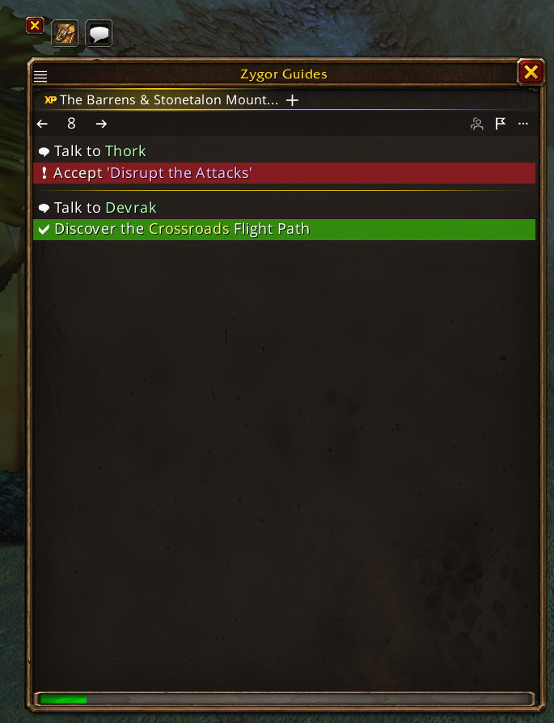

# Zygor Forever Skin

Makes the **Zygor Guides Viewer** on **World of Warcraft: Forever** look like Blizzard's own windows. Built entirely from Blizzard's own UI.

## Features

- Blizzard's window frame, title and close button
- Steps as list rows, with the current step highlighted
- Tabs, progress bar and action buttons in Blizzard's style
- Zygor's settings are never changed; turn the skin off anytime

## Install

Requires Zygor Guides Viewer (Forever). Copy the `ZygorForeverSkin` folder to `World of Warcraft/_forever_/Interface/AddOns/`.

## Usage

| Command | |
| --- | --- |
| `/zfs` | Turn the skin on or off |
| `/zfs options` | Open the settings |
| `/zfs debug` | Print diagnostics |

## License

[GPL-3.0-or-later](LICENSE)
